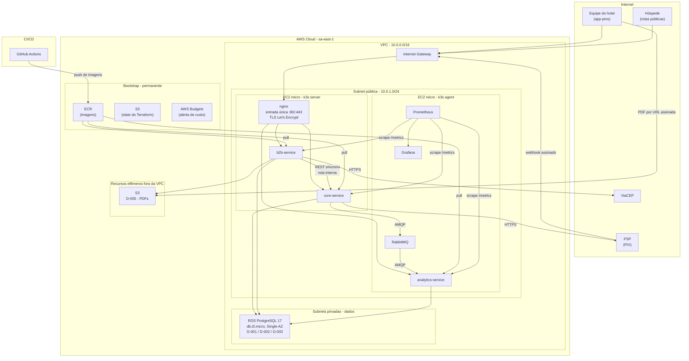

# Desenho de Arquitetura em Nuvem

---

**Projeto:** Gesway — Sistema de Gestão Hoteleira (PMS SaaS)<br>
**Grupo:** Gesway — Gabriel Reis Cunha (6325149)<br>
· Sirlande Martins (6325269)<br>
· Weslley Lucas (6325226)<br>
**Provedor de Nuvem:** AWS — região `sa-east-1` (São Paulo)<br>
**Data:** 12/10/2026<br>
**Versão:** 1.1

---

## 1. Objetivo

Este documento apresenta a arquitetura em nuvem do Gesway: os serviços, as redes, os recursos e as integrações usados na AWS. Toda a infraestrutura é provisionada por **Terraform**.

**O documento é normativo.** Ele descreve a arquitetura-alvo, e não o que já está provisionado. Recursos que ainda não existem aparecem normalmente, sem marcação de status. O acompanhamento da execução é feito no Documento 08.

**Restrição que orienta todo o desenho.** O projeto tem uma regra absoluta: **permanecer sempre no free-tier da AWS**, sem exceção por valor. Por isso, cada escolha abaixo foi feita primeiro pelo custo. A infraestrutura é **efêmera**: `terraform apply` no início de cada sessão de trabalho ou de demonstração e `terraform destroy` ao final. Ela precisa ser descartável e reconstruível em minutos.

### Decisões de referência

Este documento depende de decisões que serão registradas no Documento 07, que vem depois na ordem de entrega. Para que possa ser lido sozinho, o que ele usa de cada decisão está resumido abaixo.

| Decisão | O que este documento usa dela |
|---|---|
| **ADR-003** — recorte de serviços | Três serviços: `core-service`, `b2b-service` e `analytics-service`, cada um com o seu banco. Eventos do core para o analytics pelo **RabbitMQ**; SQS e Redis Streams foram avaliados e rejeitados. A chamada do b2b ao core usa **rotas internas, não publicadas pelo nginx** |
| **ADR-004** — nuvem | AWS, com **k3s em EC2**, e não EKS: o *control plane* do EKS custa cerca de US$ 73/mês mesmo parado e nunca entra no free-tier |
| **ADR-005** — containerização | Docker e Kubernetes (k3s). O Docker Compose é a contingência para a defesa sem nuvem |
| **ADR-006** — identidade entre serviços | O `core-service` é o único emissor de token (JWT RS256). Não existe "Auth Service" separado. As rotas internas exigem o cabeçalho `X-Internal-Token` |

---

## 2. Visão Geral da Arquitetura



A distribuição dos pods entre os dois nós é indicativa. Quem decide o nó é o *scheduler* do k3s, a partir dos `requests` de cada pod. "EC2 micro" é `t2.micro` ou `t3.micro`, conforme a elegibilidade da conta (ver §6).

**Por que dois nós *micro* e não um `t3.small`.** A soma dos `requests` dos três serviços, do RabbitMQ, do nginx e da observabilidade passa de 1 GiB, antes ainda do consumo do próprio k3s. Um único nó de 1 GiB não comporta tudo. Um `t3.small` comportaria, mas não há garantia de que seja elegível ao free-tier da conta, e a regra do projeto não admite recurso fora dele. Dois nós de 1 GiB, um *server* e um *agent* do k3s, somam 2 GiB com instâncias elegíveis. As horas gratuitas de EC2 são contadas por instância: dois nós ligados por 4 horas consomem 8 horas do limite mensal.

**Capacidade a confirmar no primeiro `apply`.** A documentação do k3s recomenda 2 GB para o nó *server*, e aqui ele tem 1 GiB. Para caber, o desenho adota três medidas:

- o k3s é instalado **sem o Traefik** (`--disable traefik`), que disputaria a porta 80 com o nginx e consumiria memória. O ServiceLB do k3s é mantido só para publicar o nginx nas portas 80/443 do nó;
- o *user-data* cria um *swapfile* de 1 GB em cada nó, dentro do disco já previsto;
- o consumo real é medido no primeiro `apply`. Se algum pod ficar em `Pending` por falta de memória, a resposta é retirar a observabilidade do cluster ou réplicas, **nunca** aumentar o tipo da instância.

**O que sai do cluster para caber no free-tier:**

- **PostgreSQL** sai do nó e vai para o **RDS**, em subnet privada. Isso libera memória do cluster e atende a exigência de banco em subnet privada.
- **MinIO** é substituído pelo **S3**. O código já usa o SDK do S3 (`@aws-sdk/client-s3`), mas a troca exige um ajuste no código, descrito na §3.5.
- **Redis** não é provisionado. Nenhum código do sistema o chama.
- O `core-service` roda com **1 réplica**. As 3 réplicas dos manifests locais eram um ajuste do minikube e não fazem sentido em nós de 1 GiB.

---

## 3. Inventário de Recursos Cloud

### 3.1 Computação

| Recurso | Serviço | Configuração | Finalidade |
|---------|---------|--------------|------------|
| Nó *server* do k3s | EC2 `t2.micro` ou `t3.micro` (ver §6) | 1 GiB, EBS gp3 de 15 GB, Amazon Linux 2023, *swapfile* de 1 GB, k3s sem Traefik | *Control plane* do k3s e pods de aplicação |
| Nó *agent* do k3s | EC2 `t2.micro` ou `t3.micro` (ver §6) | 1 GiB, EBS gp3 de 15 GB, Amazon Linux 2023, *swapfile* de 1 GB | Pods de aplicação, mensageria e observabilidade |
| nginx | Pod no k3s | 1 réplica · 50m / 64Mi · portas 80 e 443 | Única entrada pública; termina o TLS, faz proxy reverso e limita a taxa no login. Não valida token (ADR-006), bloqueia `/metrics` e não publica as rotas internas |
| core-service | Pod no k3s | 1 réplica · 100m / 128Mi · porta 3000 | Identidade e **único emissor de token**, hospedagem, reservas, pagamentos e PIX, consumo, reserva direta |
| b2b-service | Pod no k3s | 1 réplica · 100m / 128Mi | Clientes corporativos, orçamentos, contratos e PDFs |
| analytics-service | Pod no k3s | 1 réplica · 100m / 128Mi | Indicadores calculados a partir de projeções alimentadas por evento |

**Não existe "Auth Service"** como no modelo. A autenticação fica no `core-service`, que é o único emissor de token (ADR-006).

### 3.2 Banco de Dados e Cache

| Recurso | Serviço | Configuração | Finalidade |
|---------|---------|--------------|------------|
| Banco relacional | RDS PostgreSQL 17 | `db.t3.micro`, **Single-AZ**, 20 GB gp2, sem acesso público, extensão `btree_gist`, sem *backup* automático e sem *snapshot* final | Persistência dos três serviços |
| D-001 DB core-service | *database* `gesway_core` na instância RDS | Usuário próprio, sem permissão nos outros *databases* | Dados do núcleo. A constraint `EXCLUDE USING gist` garante o anti-*double-booking* |
| D-002 DB b2b-service | *database* `gesway_b2b` na instância RDS | Usuário próprio | Clientes corporativos, orçamentos e contratos |
| D-003 DB analytics-service | *database* `gesway_analytics` na instância RDS | Usuário próprio | Projeções de leitura, alimentadas só por evento |
| Cache | — | Não utilizado | Nenhuma consulta exigiu cache. O Redis dos manifests locais não é chamado por nenhum código |

**Uma instância, três *databases*.** A ADR-003 dá a cada serviço um banco próprio. No free-tier cabe apenas uma instância RDS, então cada serviço recebe um *database* e um usuário que só alcança o seu. O isolamento que a ADR-003 decidiu fica preservado no nível lógico: nenhum serviço consegue ler o banco de outro. Separar em instâncias físicas é só mudança de Terraform e de *connection string*, sem mudança de código.

**Single-AZ** é decisão consciente. Multi-AZ fica fora do escopo por custo.

**Os dados são efêmeros.** O RDS é destruído ao final de cada sessão, sem *snapshot* final (`skip_final_snapshot = true`) e sem retenção de *backup* (`backup_retention_period = 0`): *snapshots* guardados consumiriam armazenamento além do limite gratuito. A cada sessão, o `migrate` e o `seed` recriam o estado de demonstração.

### 3.3 Rede

| Recurso | Configuração | Finalidade |
|---------|--------------|------------|
| VPC | `10.0.0.0/16` | Isolamento de rede |
| Subnet pública | 1 subnet, `10.0.1.0/24`, AZ `sa-east-1a` | Os dois nós do k3s, com IP público |
| Subnets privadas de dados | 2 subnets, `10.0.20.0/24` (`sa-east-1a`) e `10.0.21.0/24` (`sa-east-1b`), sem rota para a internet | RDS. O *DB subnet group* exige duas AZs, mas a instância roda numa só |
| Internet Gateway | 1, associado à subnet pública | Entrada e saída da internet para os nós |
| Elastic IP | 1, no nó *server*, liberado no `destroy` | Endereço público estável durante a sessão, para o nginx e para o `kubectl`. Muda a cada sessão |
| Security Groups | `sg-node` e `sg-db` (ver §4.2) | Controle de acesso |
| Load Balancer | **Não utilizado** | O nginx dentro do cluster é a entrada única. Um ALB não é necessário com um único ponto de entrada e acrescentaria custo |
| NAT Gateway | **Não utilizado** | É cobrado por hora e não entra no free-tier. Os nós ficam na subnet pública e saem pela internet pelo Internet Gateway. O RDS não precisa de saída |
| DNS | **Não utilizado** (sem Route 53) | Uma zona hospedada é cobrada por mês. O nome público vem do próprio IP, pelo sslip.io (ver §4.3) |

### 3.4 Mensageria e Eventos

| Recurso | Serviço | Finalidade |
|---------|---------|------------|
| D-004 Message broker | **RabbitMQ 4** (`rabbitmq:4-management-alpine`), *StatefulSet* no k3s, 100m / 128Mi, volume persistente no EBS do nó | Eventos de domínio do `core-service` para o `analytics-service`. *Exchange* `gesway.core.events`, fila `analytics.core-events`, novas tentativas e fila de mensagens mortas. O core publica a partir de um *outbox* transacional |

SQS e SNS não são usados: a ADR-003 escolheu o RabbitMQ e rejeitou o SQS nas alternativas.

### 3.5 Armazenamento

| Recurso | Serviço | Finalidade |
|---------|---------|------------|
| D-005 Armazenamento de objetos | **S3**, bucket privado, *Block Public Access* ativo, `force_destroy = true` | PDFs de contrato e de orçamento. O download é feito por URL assinada de 5 minutos, que o navegador abre direto no S3 |
| State do Terraform | **S3**, bucket separado, com versionamento | State compartilhado da equipe (ver §5.2). **Não** é destruído no ciclo efêmero |
| Volumes dos nós | **EBS gp3**, 2 × 15 GB | Sistema, *swapfile*, imagens de contêiner e volumes persistentes do RabbitMQ e do Prometheus |

O bucket de PDFs é destruído com o ambiente, junto com o banco que referencia os arquivos. Sem `force_destroy`, o `terraform destroy` falharia com o bucket não vazio.

**Ajuste de código para trocar o MinIO pelo S3.** O cliente atual (`services/core-service/database/connections/minio.js`) foi escrito para o MinIO e não funciona no S3 só com configuração:

- a região está fixa em `us-east-1`; no S3 precisa ser `sa-east-1`, configurável;
- as credenciais são obrigatórias e estáticas (`MINIO_ROOT_USER`). Na nuvem, o *upload* usa a credencial do *instance profile* do nó (cadeia padrão do SDK), sem chave no cluster;
- a URL assinada usa o endereço do nginx e um usuário leitor do MinIO. No S3, a URL aponta para o próprio S3 e é assinada por uma credencial que só tem `s3:GetObject` no bucket de PDFs.

### 3.6 Monitoramento e Observabilidade

| Recurso | Serviço | Finalidade |
|---------|---------|------------|
| Métricas | **Prometheus 3.1**, contêiner no k3s, retenção de 2 dias, 50m / 128Mi | Coleta o `/metrics` dos três serviços (Express + `prom-client`): latência por endpoint, taxa de erro e requisições por tenant. O `/metrics` só é acessível de dentro do cluster |
| Dashboards | **Grafana 11.4**, contêiner no k3s, com login, sem acesso anônimo, 50m / 96Mi | Dashboard de saúde do sistema para a defesa |
| Logs | Saída padrão dos contêineres, lida com `kubectl logs` | Centralizar logs no CloudWatch não é necessário em ambiente efêmero, e o volume de ingestão poderia sair do free-tier |
| Alerta de custo | **AWS Budgets**, orçamento de US$ 1 com alerta por e-mail | Avisa se algum recurso sair do free-tier, por exemplo um nó esquecido ligado |

O acesso ao Grafana e ao Prometheus é feito por `kubectl port-forward`, a partir do IP da equipe. Nenhum dos dois é exposto pela porta pública. A observabilidade é aplicada separadamente dos serviços, para poder ficar de fora se a memória dos nós não comportar (§2).

### 3.7 CI/CD e Registry

| Recurso | Serviço | Finalidade |
|---------|---------|------------|
| Pipeline | **GitHub Actions** | Checagens determinísticas, testes com portão de cobertura de 60% e *build* das imagens, com *push* para o ECR só se os testes passarem. **Não faz *deploy***: o cluster só existe durante a sessão, e a API do k3s só aceita o IP da equipe |
| Container Registry | **ECR**, um repositório privado por serviço, criado no `bootstrap/` e **permanente** | Imagens Docker do `core-service`, do `b2b-service` e do `analytics-service`. A *lifecycle policy* guarda só as 2 últimas imagens de cada repositório, para ficar abaixo dos 500 MB gratuitos |
| Credenciais do pipeline | *Secrets* do GitHub, para um usuário IAM com permissão só de *push* no ECR | Nenhuma credencial no código. Nenhum uso do usuário `root` da conta |

O *deploy* é feito pela equipe, no passo 3 do ciclo de cada sessão (§5.1), a partir das imagens que já estão no ECR.

---

## 4. Estratégia de Rede e Segurança

### 4.1 Diagrama de Rede

```
VPC: 10.0.0.0/16 (sa-east-1)
├── Internet Gateway
├── Public Subnet A (10.0.1.0/24) - sa-east-1a
│   ├── EC2 k3s server (micro) + Elastic IP
│   │   └── nginx, core-service, b2b-service
│   └── EC2 k3s agent (micro)
│       └── analytics-service, RabbitMQ, Prometheus, Grafana
├── Private Subnet Data A (10.0.20.0/24) - sa-east-1a
│   └── RDS PostgreSQL (Single-AZ)
└── Private Subnet Data B (10.0.21.0/24) - sa-east-1b
    └── (reservada: exigência do DB subnet group, sem instância)
```

Sem subnets de aplicação privadas, sem NAT Gateway e sem segunda AZ ativa: os três exigiriam recursos fora do free-tier. Alta disponibilidade multi-AZ fica fora do escopo por custo.

Dentro do cluster, as `NetworkPolicy` (versionadas em `infra/k8s/networkpolicy.yaml`) restringem quem fala com quem: só o nginx recebe tráfego de fora, e só os serviços alcançam o RabbitMQ. As rotas internas do `core-service`, usadas pelo `b2b-service`, não são publicadas pelo nginx e exigem o `X-Internal-Token` (ADR-006).

### 4.2 Security Groups

| Nome | Porta(s) | Origem | Destino | Finalidade |
|------|----------|--------|---------|------------|
| sg-node | 80, 443 | `0.0.0.0/0` | Nó *server* (nginx) | Única entrada pública: equipe, hóspede e o *webhook* do PSP. A porta 80 serve ao desafio do Let's Encrypt e redireciona para a 443 |
| sg-node | 22 | IP da equipe (`/32`) | Nós | Administração. Nunca `0.0.0.0/0` |
| sg-node | 6443 | IP da equipe (`/32`) | Nó *server* | API do k3s, para o *deploy*, o `kubectl` e o `port-forward` do Grafana |
| sg-node | Todas | `sg-node` | Nós | Tráfego interno do k3s entre *server* e *agent* |
| sg-node (saída) | 443 | Nós | `0.0.0.0/0` | PSP, ViaCEP, Let's Encrypt, *pull* do ECR e S3 |
| sg-db | 5432 | `sg-node` | RDS | Acesso ao banco só a partir dos nós do cluster |

A rota `/webhooks/pix` é pública por natureza, porque o PSP precisa alcançá-la, e é protegida por assinatura HMAC. O status do pagamento é sempre confirmado no PSP antes de ser gravado.

### 4.3 Entrada HTTPS

Sem ALB não há certificado do ACM, e sem Route 53 não há domínio próprio. A entrada HTTPS usa só recursos gratuitos:

- **Nome público:** derivado do Elastic IP pelo sslip.io (por exemplo, `203-0-113-10.sslip.io`), que resolve qualquer nome desse formato para o IP embutido nele.
- **Certificado:** emitido pelo Let's Encrypt a cada sessão, pelo desafio HTTP na porta 80, e instalado no nginx.
- **URL do *webhook*:** muda a cada sessão, junto com o IP. O Gesway informa a URL de notificação em cada cobrança PIX, então isso é configuração da sessão, sem mudança de código.

A emissão está sujeita aos limites semanais do Let's Encrypt. Se um limite for atingido, a sessão segue em HTTP para a equipe, e a demonstração do *webhook* fica para a sessão seguinte.

---

## 5. Infraestrutura como Código (Terraform)

### 5.1 Estrutura dos Módulos

```
terraform/
├── bootstrap/            # Criado uma única vez, fora do ciclo efêmero
│   └── main.tf           # Bucket S3 do state, repositórios ECR e lifecycle policy,
│                         # usuário IAM do CI (push no ECR), AWS Budgets
├── main.tf
├── variables.tf
├── outputs.tf
├── providers.tf          # AWS ~> 5, região sa-east-1, backend S3
├── modules/
│   ├── networking/       # VPC, subnets, Internet Gateway, rotas, Security Groups
│   ├── compute/          # 2 × EC2 micro, Elastic IP, user-data: swapfile e k3s sem Traefik
│   ├── database/         # RDS PostgreSQL, DB subnet group, parameter group, sem snapshot final
│   ├── storage/          # Bucket S3 dos PDFs, com force_destroy
│   └── iam/              # Instance profile dos nós: pull do ECR, escrita no bucket de PDFs
└── environments/
    └── dev/
        └── terraform.tfvars
```

**Mensageria e monitoramento não têm módulo Terraform.** O RabbitMQ, o Prometheus e o Grafana rodam dentro do k3s e são aplicados pelos manifests de `infra/k8s/`. O Terraform cuida do que é AWS; o Kubernetes cuida do que roda no cluster.

**Um único ambiente.** O ambiente `prod` do modelo não existe: o projeto tem um ambiente efêmero, que sobe para trabalho e para a demonstração.

**Ciclo de cada sessão:**

1. `terraform apply` em `terraform/` cria rede, nós, RDS e o bucket de PDFs.
2. O *user-data* cria o *swapfile*, instala o k3s sem o Traefik no *server* e junta o *agent* ao cluster.
3. A equipe aplica os manifests de `infra/k8s/` com as imagens do ECR, os *secrets* gerados na hora e não versionados, e emite o certificado do Let's Encrypt (§4.3).
4. `migrate` e `seed` rodam contra o RDS.
5. Ao final, `terraform destroy` remove tudo. Só o `bootstrap/` permanece.

### 5.2 State Management

| Item | Configuração |
|------|--------------|
| Backend | S3, com *lock* nativo do próprio S3 (`use_lockfile = true`, Terraform 1.10 ou superior) |
| State File | `s3://gesway-tfstate/env/dev/terraform.tfstate`, bucket com versionamento e criptografia, sem acesso público |
| Lock | Arquivo de *lock* no mesmo bucket. Dispensa a tabela do DynamoDB |

O bucket do state é criado pelo `bootstrap/` e **não** entra no `terraform destroy` do ciclo, senão a equipe perderia o state a cada sessão. Variáveis sensíveis, como a senha do RDS, ficam fora do Git: são geradas pelo Terraform ou vêm de `TF_VAR_*` no ambiente.

---

## 6. Estimativa de Custos

Estimativa para o ciclo efêmero: sessões de cerca de 4 horas, com até 30 sessões por mês, o que dá até 120 horas de cada recurso.

**Dois modelos de free-tier.** A AWS mudou o free-tier para contas criadas a partir de 15/07/2025, e o modelo vale pela data de criação da conta:

- **conta anterior a 15/07/2025** — limites mensais por 12 meses (750 h de EC2, 750 h de RDS etc.). Em `sa-east-1`, a instância elegível é a **`t2.micro`**: a `t3.micro` só entra nas regiões sem `t2.micro`, e São Paulo tem `t2.micro`;
- **conta a partir de 15/07/2025** — plano gratuito com créditos, por até 6 meses. A **`t3.micro`** é elegível.

**Regra de decisão:** antes do primeiro `apply`, conferir em **Billing → Free Tier**, com usuário IAM, qual modelo vale para a conta e qual tipo de instância é elegível. As duas opções têm 1 GiB de memória, e o desenho não muda. Se nenhum recurso da tabela for elegível, ele é trocado antes do *apply*, nunca depois.

A tabela abaixo usa os limites do modelo anterior, que são os mais restritivos em horas.

| Recurso | Serviço | Uso no mês | Estimativa Mensal (USD) |
|---------|---------|------------|------------------------|
| Computação | 2 × EC2 micro + 2 × 15 GB EBS gp3 | Até 240 h de instância e 30 GB de disco | 0,00 (free-tier: 750 h e 30 GB — o disco fica exatamente no limite) |
| Banco de Dados | RDS `db.t3.micro` Single-AZ, 20 GB | Até 120 h, sem *snapshot* | 0,00 (free-tier: 750 h e 20 GB) |
| Rede | Elastic IP e IP público dos dois nós, Internet Gateway, saída de dados | Até 240 h de IPv4 público; saída de poucos GB | 0,00 (free-tier: 750 h de IPv4 público e 100 GB de saída) |
| Armazenamento | S3 (PDFs e state) e ECR | S3 abaixo de 1 GB; ECR com 2 imagens por serviço | 0,00 (free-tier: 5 GB no S3 e 500 MB no ECR) |
| Monitoramento | Prometheus e Grafana no próprio cluster; AWS Budgets | Sem recurso AWS adicional | 0,00 |
| DNS e certificado | sslip.io e Let's Encrypt | Fora da AWS, gratuitos | 0,00 |
| **Total Estimado** | | | **0,00** |

**O que não foi usado por custo:** EKS (cerca de US$ 73/mês só de *control plane*), NAT Gateway, Application Load Balancer, Route 53, RDS Multi-AZ e ElastiCache.

**Controles da regra de free-tier:**

- `terraform destroy` ao final de cada sessão;
- AWS Budgets com alerta a partir de US$ 1;
- conferência periódica em **Billing → Free Tier** no console, com usuário IAM e nunca com o `root`;
- nenhum volume EBS além dos dois previstos, porque o disco já está no limite gratuito.

**Contingência:** se a nuvem estiver indisponível no dia da defesa, o sistema sobe localmente pelo Docker Compose (ADR-005).

---

## 7. Histórico de Revisões

| Versão | Data | Autor | Descrição da Alteração |
|--------|------|-------|------------------------|
| 1.0 | 10/10/2026 | Weslley Lucas | Versão inicial: k3s em dois EC2 `t3.micro` (ADR-004), RDS com três *databases* em subnet privada, S3 no lugar do MinIO, RabbitMQ e observabilidade no cluster, tudo dentro do free-tier |
| 1.1 | 12/10/2026 | Sugestão — Gabriel Reis Cunha | ECR passa ao `bootstrap/` e o CI deixa de fazer *deploy*; entrada HTTPS com sslip.io e Let's Encrypt; k3s sem Traefik e com *swapfile*, com regra para falta de memória; elegibilidade `t2.micro`/`t3.micro` pelos dois modelos de free-tier; *destroy* limpo (RDS sem *snapshot*, bucket com `force_destroy`); ajuste de código para o S3; rotas internas da ADR-003/006; IPv4 corrigido para 240 h |

---

**Aprovado por:**

___________________________________________________
Professor(a) Orientador(a)

Data: ___/___/2026
